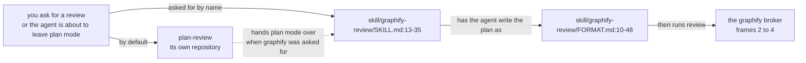
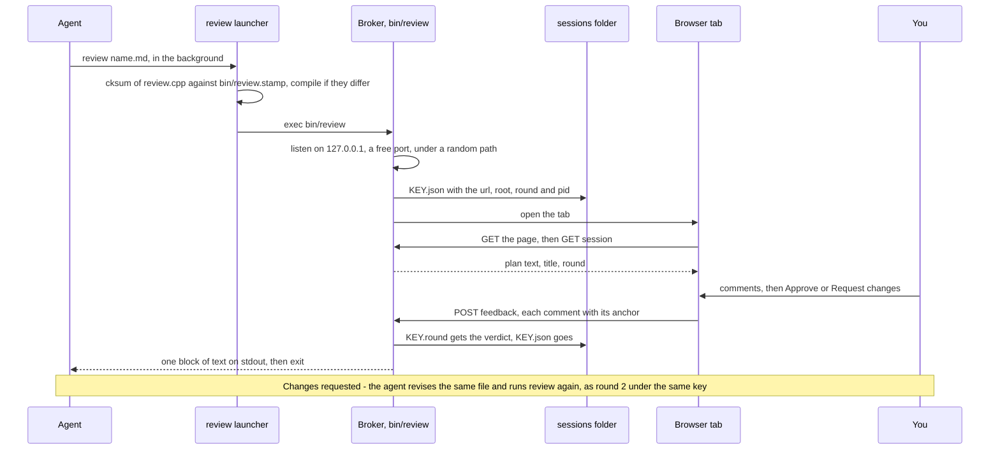
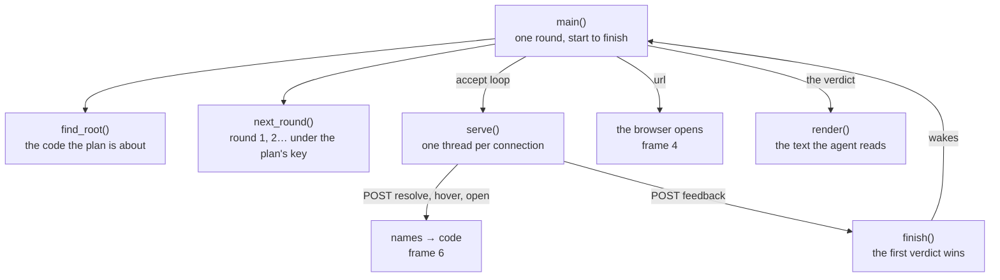
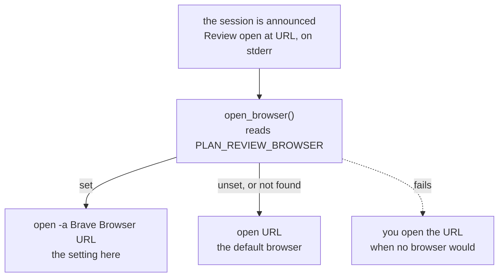
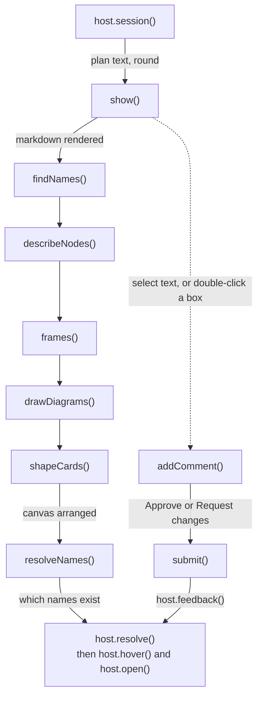
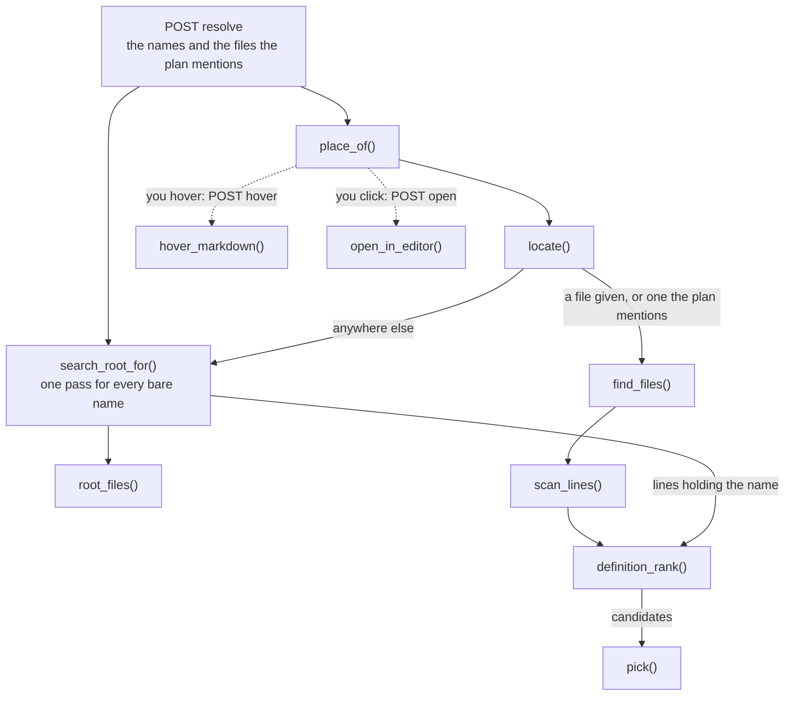
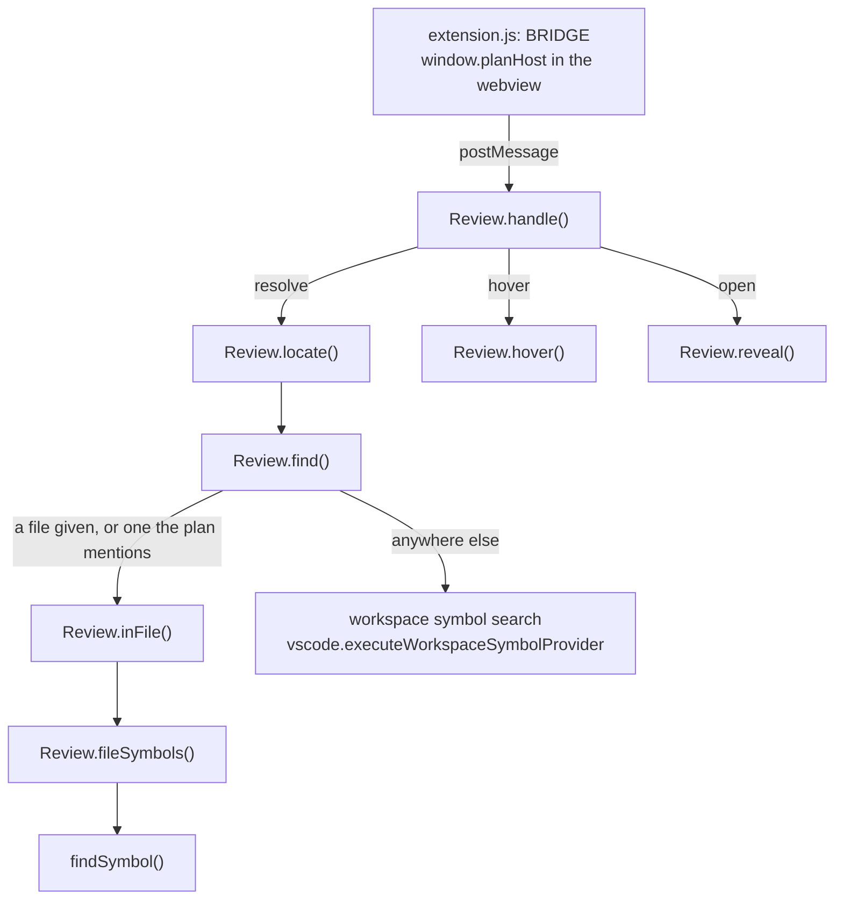
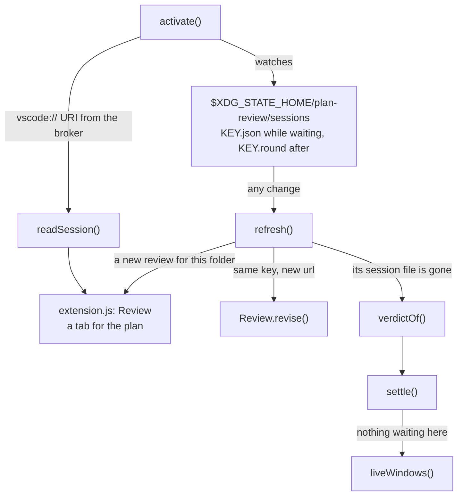

# How graphify-review works

An Agent Skill: a folder an agent reads (its SKILL.md) plus a small C++ program the agent
runs. The agent's skills folder links to this repo's `skill/graphify-review/` folder. It
shows a plan as a canvas of diagrams, like this one, where every function it names is a
hover or a click away from the code, and it runs only when asked for by name.

Its sibling, plan-review, lives in a repository of its own: the classic review, where
the plan opens as a document and you comment on its text. It runs on `/plan-review`,
and on its own before an agent leaves plan mode. graphify-review's broker began as
plan-review's, before sessions, viewers and names.

graphify-review has three parts, and most of this canvas is about them:

1. **The broker**, `skill/graphify-review/review.cpp`: it holds one round of one review.
   The agent only ever runs this.
2. **The viewer**: one page, `skill/graphify-review/page.html`, in a browser tab. A name
   it shows hovers with its definition and opens in your editor when clicked. The VS Code
   viewer that came before is archived in `archive/vscode/`; the archived frames at the
   end show how it worked.
3. **The plan format**, `skill/graphify-review/FORMAT.md`: how the agent writes a plan so
   the page can draw it and link its names.

To see this file as a canvas, run `skill/graphify-review/review ARCHITECTURE.md` from the
repository root. When the architecture changes, change this file.

## 1. Which skill runs

- **plan-review**, in its own repository: its SKILL.md runs before the host's
  plan-approval gate (`exit_plan_mode` in Claude Code), as a human checkpoint in front of
  it, not a replacement. If you asked for a graphify review, it steps aside so the plan
  isn't reviewed twice. graphify-review's step 0 takes that checkpoint instead.
- **`skill/graphify-review/SKILL.md`** (lines 13-35): names the plan file for the session
  (2-5 kebab-case words, never plan.md), runs the review in the background, and acts on
  the one line that comes back.
- **`skill/graphify-review/FORMAT.md`** (lines 10-48): code-flow flowcharts whose boxes
  are real places in the code, a list entry per box that starts with its name (the page
  moves it into the box), and names written so they can be found. This canvas is written
  in it.

## 2. One round, start to finish

- The agent runs one command and reads one block of text: `APPROVED`,
  `APPROVED WITH NOTES`, `CHANGES REQUESTED` with numbered comments, or `ENDED`, then
  any diagrams that didn't draw, with the parser's error. Ports, tabs and windows are the
  broker's business.
- The launcher is a shell script beside the SKILL.md. It builds to a temporary path and
  moves the binary into place, so a broker that's running is never overwritten.
- The URL's path is a random 22-character token, so another local page can't read the
  plan or post feedback.
- The broker also answers only requests addressed to 127.0.0.1 and its port, refuses a
  POST from another page's origin, and sends the page a Content-Security-Policy, so the
  page loads and sends nothing off the machine: a plan's remote image doesn't load.
  Session files are readable by you alone, and a quiet connection is dropped after 5 s.
- Closing the tab is an answer too: the page sends an end marked as leaving, and the
  broker holds it 2 seconds, so a reload takes the review back.
- A broker that's killed removes its session file in its signal handler, so no viewer
  keeps showing a dead review.

## 3. Inside the broker

- **`main()`** (`graphify-review/review.cpp`): reads the plan, builds the page once
  (marked pasted in at its placeholder), listens on port 0, opens the browser, then sleeps
  until a verdict arrives or the viewer has been gone 2 seconds.
- **`find_root()`** (`graphify-review/review.cpp`): `--root`, else the top of the git
  repository the review runs in, else the current folder. Names are looked up here.
- **`next_round()`** (`graphify-review/review.cpp`): the key is the file name without .md,
  and the same plan back within a day is the next round. The session file is written
  beside the target and renamed over it, so a viewer never reads half of it.
- **`serve()`** (`graphify-review/review.cpp`): one request per connection. GETs serve the
  page, the session and Pele, the diagram renderer, which only a plan with diagrams
  fetches; POSTs carry JSON, read by the broker's own small parser. `POST drawn` keeps
  the diagrams the page couldn't draw, for `not_drawn()` to tell the agent.
- **`finish()`** (`graphify-review/review.cpp`): the first verdict wins and wakes
  `main()`. A viewer that went away sets `set_leaving()` instead, which a reload clears.
- **`render()`** (`graphify-review/review.cpp`): the verdict and each numbered comment,
  with `where()` saying what it's about: quoted prose, a diagram's box, or lines of code.

## 4. Where the review opens

- **`open_browser()`** (`graphify-review/review.cpp`): an app name on macOS, a command on
  Linux. Here it's Brave, so reviews stay out of the default browser. The URL is printed
  first, so a review that no browser opens can still be reached.

Before the archive, `PLAN_REVIEW_VIEWER=vscode` opened the review in VS Code here instead
(archived frames A and B).

## 5. The page: one round on the canvas

- **`host.session()`** (`graphify-review/page.html`): the page never talks to the broker
  itself, only to `host`. In a browser tab that's the default object here, which calls
  the broker that served the page. A viewer that hosts the page itself, as the archived
  VS Code viewer did, sets `window.planHost` first and answers the same calls.
- **`show()`** (`graphify-review/page.html`): resets the page for a round, renders the
  plan with marked, and turns each mermaid block into a diagram waiting to be drawn.
- **`findNames()`** (`graphify-review/page.html`): wraps each name written in the plan
  format in a span carrying its key: in prose an HTML span, in a drawn box an SVG tspan.
- **`describeNodes()`** (`graphify-review/page.html`): a list item that starts with a
  box's name moves into that box, which is what turns these flowcharts into cards. It
  looks only between the diagram and the next diagram or heading (`entriesAfter()`), so
  the plan's other bullets never land in a box.
- **`frames()`** (`graphify-review/page.html`): the text before the first heading is the
  intro card, and each section a frame, in one column that `arrange()` opens at the zoom
  where the widest frame fits beside the panel.
- **`drawDiagrams()`** (`graphify-review/page.html`): Pele (`pele.min.js`) draws each
  block as SVG, all of them here in under 10 ms, in the page's colours through its
  `--pele-*` variables, so a change to dark mode needs no redraw. A block that won't parse
  shows its source, and `host.drawn()` tells the broker.
- **`shapeCards()`** (`graphify-review/page.html`): Pele centres every line, so a box with
  a description gets its title over a rule and its lines left-aligned under it.
- **`resolveNames()`** (`graphify-review/page.html`): asks once for all names, with the
  files the plan mentions as places to look first. The broker answers the first time and
  keeps its misses, so the retries at 3, 10 and 30 seconds cost nothing; they were for
  the archived viewer's language servers, still starting.
- **`addComment()`** (`graphify-review/page.html`): `anchorOf()` says what a comment is
  about: quoted prose, or a diagram and its box.
- **`submit()`** (`graphify-review/page.html`): sends the verdict. Closing the tab sends an
  end through `host.leave()`, as a beacon.

## 6. Names → code: the broker reads the text, your editor opens it

- **`search_root_for()`** (`graphify-review/review.cpp`): reads every file once, on up to
  8 threads, splitting it into identifiers and checking only lines holding a wanted one.
  0.28 s on 7,000 files; git grep with a pattern per name took 3 s.
- **`root_files()`** (`graphify-review/review.cpp`): git's files, tracked or not ignored;
  outside git, a walk that skips hidden, dependency and build folders.
- **`place_of()`** (`graphify-review/review.cpp`): each answer is kept for the broker's
  life, so a hover or a click never searches again.
- **`locate()`** (`graphify-review/review.cpp`): a name with a file looks only there. A
  bare name tries the files the plan mentions in order, then the whole root; a qualified
  one, like `Review.find()`, first has to be inside that class.
- **`find_files()`** (`graphify-review/review.cpp`): the path from the root, or every file
  whose path ends in it, shortest first.
- **`definition_rank()`** (`graphify-review/review.cpp`): reads a line the way definitions
  look in most languages: a keyword, a signature, a field. A use, a call or a `return` of
  the name doesn't count.
- **`pick()`** (`graphify-review/review.cpp`): the surest shape, then the shortest path,
  then the earliest line. Text can't follow imports, so a library's functions stay
  unlinked.
- **`hover_markdown()`** (`graphify-review/review.cpp`): what a hover shows: the
  definition's lines, to where its first block closes (at most 15). No types, since no
  language server runs.
- **`open_in_editor()`** (`graphify-review/review.cpp`): what a click does: runs
  `PLAN_REVIEW_EDITOR` with path:line (here, `zed`); unset, Zed, else VS Code, else the
  file's default app.

## 7. Why it's built this way

- RAM is the measure. A browser review costs the broker (1.5 to 7 MB in testing) and one
  tab; VS Code's language servers took about 2.8 GB on a large Angular repository even in
  the lean review instance, and about 7 GB in a VS Code with a full set of extensions.
- Pele, not Mermaid, draws the diagrams. On this canvas, when it had nine, it drew them
  all in under 10 ms, where Mermaid took 110 to 150, from 680 KB of JavaScript against
  3.5 MB, and the tab's JavaScript heap was 4.3 MB against 8.1 MB.
- Nothing to install but a C++17 compiler: the standard library and POSIX sockets, marked
  and Pele bundled, everything offline on 127.0.0.1.
- Any agent that reads SKILL.md can use it (Claude Code, Codex, Gemini CLI, Cursor),
  because all it does is run one command and read its output.
- A viewer is anything that speaks the session protocol: find the session file, then GET
  session, POST feedback and, for names, POST resolve, hover and open. The README
  documents it for writing another.
- Zed can't host the canvas, since its extensions add no UI, so it gets the clicks
  instead: a name opens there at its line.

## 8. Now and before: the browser and the VS Code viewer

The same broker, page and plan format. What changed is who answers the page's questions
about the code, and where a click goes.

| | Now: the browser | Before: VS Code |
| --- | --- | --- |
| The canvas opens in | a Brave tab | a tab in a separate VS Code, the review instance |
| Names are found by | the broker, reading the code's text | VS Code's language servers |
| Memory for a review | the broker (1.5 to 7 MB) and one tab | about 2.8 GB on a large Angular repository |
| Names link | about 0.3 s after the page draws, on 7,000 files | once the language servers have started; misses are asked again at 3, 10 and 30 s |
| Names found on a 45-name plan | 41 | the same 41 |
| A hover shows | the definition's lines, up to 15, without types | the language server's hover: signature, types, docs |
| A click opens | Zed, at the file and line | the definition in VS Code, beside the plan |
| Comments go on | the plan's prose and its boxes | those, and lines selected in the editor |
| Round 2 | opens in a new tab; the old one says it's done | reloads in the same tab |
| When it's over | you close the tab | the window closes itself, and the last one quits the instance |

The switch was for memory: the browser gives up the types in a hover and keeps every link.

## Archived A. Names → code in VS Code, through the language servers

The VS Code viewer, before the browser took over. Its code is in `archive/vscode/`, and
`archive/vscode/README.md` says how to run it again.

- **`BRIDGE`** (`archive/vscode/extension.js`): put in front of the page in the webview,
  it turns each `host` call into a message to the extension and back. The page is the
  same file the browser shows, loaded from the skill's folder.
- **`Review.handle()`** (`archive/vscode/extension.js`): session and feedback go on to
  the broker over HTTP; resolve, hover and open it answers itself.
- **`Review.locate()`** (`archive/vscode/extension.js`): keeps each answer for the round,
  but not a miss: the language server may still be starting.
- **`Review.find()`** (`archive/vscode/extension.js`): the broker's order, through the
  language servers: the file given, the files the plan mentions, then the workspace.
- **`Review.fileSymbols()`** (`archive/vscode/extension.js`): document symbols work even
  where workspace search can't, as in plain JavaScript with no jsconfig.
- **`Review.hover()`** (`archive/vscode/extension.js`): the language server's own hover,
  with the types and docs the browser can't show.
- **`Review.reveal()`** (`archive/vscode/extension.js`): opens the code beside the plan.
  The price is the language servers: about 2.8 GB on a large Angular repository.

## Archived B. How VS Code finds a review, and when it closes

- **`activate()`** (`archive/vscode/extension.js`): watches the sessions folder, takes
  the broker's URI, and brings back a review tab VS Code had open when it quit, if its
  round is still waiting.
- **`refresh()`** (`archive/vscode/extension.js`): a new round reloads its tab, a round
  that ended elsewhere is marked ended, and the status bar counts reviews not shown here.
- **`readSession()`** (`archive/vscode/extension.js`): a session whose broker's pid is
  dead is ignored.
- **`extension.js: Review`** (`archive/vscode/extension.js`): one webview tab per plan,
  kept alive while hidden.
- **`Review.revise()`** (`archive/vscode/extension.js`): round 2 reloads the same tab.
- **`verdictOf()`** (`archive/vscode/extension.js`): KEY.round holds the round, and once
  it ends, its verdict on a second line, so a window tells finished from coming back.
- **`settle()`** (`archive/vscode/extension.js`): a review window with nothing waiting
  closes after 1.5 s, or 10 minutes after you request changes, if no revision came.
- **`liveWindows()`** (`archive/vscode/extension.js`): the last review window quits the
  instance, which on macOS would otherwise keep running with no window.

The review instance is a separate VS Code (`--user-data-dir`), not a profile, because
`--profile` ties the folder to that profile for good.
