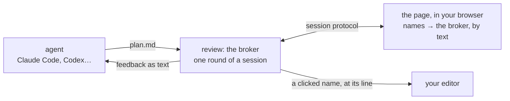

# plan-review

Review coding-agent plans with inline comments, in two ways. Each is an [Agent Skill](https://agentskills.io), so it works in Claude Code, Codex, Gemini CLI, Cursor and any other tool that reads `SKILL.md`.

- **plan-review**: the classic review. The plan opens as a document in your browser; you comment on its text. It also runs on its own before an agent leaves plan mode.
- **graphify-review**: the plan as a canvas of diagrams in your browser, with every function it names one hover or click away from the code. It runs when you ask for it.

In both, select text → **Comment**. Add an optional general comment, then **Approve** or **Request changes**.
The agent receives each comment with what it's about, and revises the plan.

Don't want to say anything? **End review without feedback** — or just close the review — ends it. The agent is told the review stopped with no instructions, and waits for you instead of guessing.

Everything runs locally and offline, from `127.0.0.1`, with the renderers bundled.

## plan-review

Ask for a plan review (`/plan-review`, or `/plan-review path/to/file.md`), and the plan opens in a local page.
The page is served in a single response, with the plan and the markdown renderer built into the HTML, so there are no network requests.

To use a browser other than your default, set `PLAN_REVIEW_BROWSER` (see [Install](#install)).

## graphify-review

Ask for it by name (`/graphify-review`, or `/graphify-review path/to/file.md`). The agent writes the plan in the [plan format](skill/graphify-review/FORMAT.md) first, and the plan opens as a canvas in your browser. A revised plan comes back as the next round of the same review, in a new tab.

### Three parts



- **The channel.** `review` is the broker: it holds one round of a plan's review, announces it, opens it in your browser, and prints the feedback when it comes back. Agents only ever run this command.
- **The viewer.** One page, [`page.html`](skill/graphify-review/page.html), in a browser tab. It asks the broker which of the plan's names are in the code, and the broker answers from the code's text. Anything else that speaks the [session protocol](#session-protocol) can be a viewer too.
- **The plan format.** [`FORMAT.md`](skill/graphify-review/FORMAT.md): a code-flow flowchart, a description entry per changed node, and names written as `file: name()` or `path/file.ts:42-60`. The skill has the agent write plans this way.

### The canvas

The plan is one canvas filling the window, not a document. The intro is a card, each `##` section a frame, and each flowchart box carries its description entry inside it, so the diagram is the explanation. Drag empty space or scroll to move around; ⌘-scroll or pinch to zoom; **Fit** shows everything. Comments sit in a panel on the right: select text, or double-click a box, to comment on it.

It opens in your default browser, or the one `PLAN_REVIEW_BROWSER` names, like plan-review. No language server starts: a review costs the broker (a few MB) and one tab.

- Every name in the plan that is defined in the code becomes a link. The broker finds it by text: the file the plan names, else the files it mentions, else one pass over the repository's files (git's, or a walk that skips dependency and build folders) that checks only the lines mentioning the name for the shapes definitions take in most languages: `function x`, `class X`, `def x`, `x(…) {`, `public x: T`. On a 7,000-file Angular repository it found the same 41 of a plan's 45 names as VS Code's language servers, in 0.3 seconds.
- Hover a name for the lines of its definition (no types: there is no language server); click it to open it in your editor at that line. `PLAN_REVIEW_EDITOR` is the command that opens `path:line` (`zed`, `code -g`, `subl`); unset, it is Zed if `zed` is on your `PATH`, else VS Code, else the file's default app.
- Text can't follow imports: a name defined in more than one place goes to the shortest path, and a library's functions (`switchMap`) aren't found.

### The archived VS Code viewer

graphify-review used to open in VS Code as well, where the language servers found the names: a hover had types, and you could comment on lines of code. A review took about 2.8 GB on a large repository, against the browser's few MB, so it's archived in [`archive/vscode/`](archive/vscode/README.md), with how it worked and how to run it again.

## Install

Clone the repo, then link both skills into your tool's skills directory:

```sh
git clone https://github.com/shyamalaravind/plan-review.git
for s in plan-review graphify-review; do
  ln -s "$PWD/plan-review/skill/$s" ~/.claude/skills/$s   # Claude Code
  ln -s "$PWD/plan-review/skill/$s" ~/.codex/skills/$s    # Codex (Cursor reads this too)
  ln -s "$PWD/plan-review/skill/$s" ~/.gemini/skills/$s   # Gemini CLI
done
```

Create the skills directory first if it doesn't exist. Requires a C++17 compiler — `clang++` from the Xcode command line tools on macOS (`xcode-select --install`), or `g++` on Linux. No packages, no runtime.

Each skill builds its own binary on its first review (~1s); after that it starts in a few milliseconds. To build them ahead of time: `make -C skill/plan-review && make -C skill/graphify-review`.

To pick the browser reviews open in and the editor a clicked name opens in:

```sh
export PLAN_REVIEW_BROWSER="Brave Browser"   # both skills; macOS. brave-browser on Linux
export PLAN_REVIEW_EDITOR=zed                # graphify-review: opens path:line
```

Put these in `~/.zshenv` (or your shell's equivalent), not `~/.zshrc`. Agents run commands in non-interactive shells, and those skip `~/.zshrc`.

You can also run either without an agent: `skill/plan-review/review plan.md` (or `skill/graphify-review/review plan.md`) prints the feedback to stdout. `--title` names the review (`review resume.md --title "Apollo.io Resume Senior Software Engineer"`), so another skill that hands its document over can ask for a title. graphify-review also takes `--root <dir>`, the code the plan is about; without it, it's the git repository `review` runs in.

## Session protocol

graphify-review's, for writing another viewer. A round's broker announces itself in `$XDG_STATE_HOME/plan-review/sessions/<key>.json` (default `~/.local/state/…`), where the key is the plan's file name without `.md`:

```json
{"key": "migrate-auth", "name": "migrate-auth.md", "title": "", "url": "http://127.0.0.1:52144/<token>/",
 "root": "/path/to/repo", "assets": "/path/to/skill/graphify-review", "round": 2, "pid": 41235}
```

The file goes when the round ends, and `<key>.round` beside it then holds the round and its verdict (`2` and `approve`, on two lines), which is how a viewer knows whether the review is over or coming back revised. The same plan coming back within a day is the next round under the same key, which is how a viewer knows to refresh in place. `assets` is where `page.html` and its scripts are, for a viewer that hosts the page itself.

| Request | Does |
| --- | --- |
| `GET <url>` | the browser viewer |
| `GET <url>session` | `{key, name, title, text, root, round}` |
| `GET <url>pele.min.js` | the diagram renderer, for a page that has diagrams |
| `POST <url>feedback` | `{verdict, general, comments: [{note, anchor}]}`, where `verdict` is `approve`, `changes` or `end` |
| `POST <url>resolve` | `{keys, files}` → which of the names exist in the code, as `[true, false, …]`; a key is `{file?, name?, line?, end?}`, and `files` are the ones the plan mentions, searched first |
| `POST <url>hover` | a key → `{markdown, where}`: the lines of its definition, and `path:line` |
| `POST <url>open` | a key → opens it in `PLAN_REVIEW_EDITOR` |

A comment's `anchor` says what it's about: `{kind: "quote", quote}` for prose, `{kind: "diagram", diagram, node?, quote}` for a diagram (numbered from 1) and the node in it, `{kind: "code", file, start, end, quote}` for lines of code. `{verdict: "end", leaving: true}` means the viewer went away: the broker waits two seconds for it to come back (a reload) before ending the review.

## Layout

The two skills share no files, so each can be linked on its own.

- `ARCHITECTURE.md`: how both skills work, written in the plan format. Open it as a canvas with `skill/graphify-review/review ARCHITECTURE.md`.
- `skill/plan-review/`: the classic review.
  - `SKILL.md`: instructions the agent follows.
  - `review`: launcher. Compiles the server on first use (or after `review.cpp` changes) into `bin/review`, then runs it.
  - `review.cpp`: the server — C++17, standard library and POSIX sockets only. It serves the page, blocks until you submit or end the review, and prints the feedback.
  - `page.html`: the review page.
  - `marked.min.js`: a bundled copy of [marked](https://github.com/markedjs/marked) v12.0.2 (MIT) that renders the markdown.
- `skill/graphify-review/`: the canvas review.
  - `SKILL.md`: instructions the agent follows.
  - `FORMAT.md`: the plan format.
  - `review`: the same launcher.
  - `review.cpp`: the broker — C++17, standard library and POSIX sockets only.
  - `page.html`: the canvas page.
  - `marked.min.js`: marked v12.0.2, as above.
  - `pele.min.js`: a bundled copy of [Pele](https://github.com/obsidianmd/pele) v1.6.0 (MIT), its `dist/pele.global.js`, that draws the diagrams. It reads Mermaid's syntax, so plans still use ```` ```mermaid ```` blocks.
- `archive/vscode/`: graphify-review's VS Code viewer, archived. Its README says how it worked and how to run it again.
