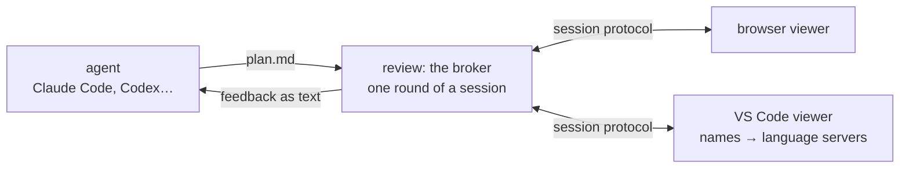

# plan-review

Review coding-agent plans with inline comments, as diagrams first, with every function they name one hover or click away from the code. It's an [Agent Skill](https://agentskills.io), so it works in Claude Code, Codex, Gemini CLI, Cursor and any other tool that reads `SKILL.md`.

Ask for a plan review (`/plan-review`, or `/plan-review path/to/file.md`), and the plan opens in a viewer: a local page in your browser, or a tab in VS Code.
Select text in the prose or a diagram → **Comment**. Add an optional general comment, then **Approve** or **Request changes**.
The agent receives each comment with what it's about, and revises the plan. The revised plan comes back to the same review.

Don't want to say anything? **End review without feedback** — or just close the review — ends it. The agent is told the review stopped with no instructions, and waits for you instead of guessing.

## Three parts



- **The channel.** `review` is the broker: it holds one round of a plan's review, announces it, opens your viewer, and prints the feedback when it comes back. Agents only ever run this command.
- **The viewers.** Anything that speaks the [session protocol](#session-protocol). The same page runs in both: the browser shows it as is, and the VS Code extension hosts it in a tab and answers its questions about the code.
- **The plan format.** [`FORMAT.md`](skill/plan-review/FORMAT.md): a code-flow flowchart, a description entry per changed node, and names written as `file: name()` or `path/file.ts:42-60`. The skill has the agent write plans this way.

## Viewers

Both viewers show the plan as one canvas filling the window, not as a document. The intro is a card, each `##` section a frame, and each flowchart box carries its description entry inside it, so the diagram is the explanation. Drag empty space or scroll to move around; ⌘-scroll or pinch to zoom; **Fit** shows everything. Comments sit in a panel on the right: select text, or double-click a box, to comment on it.

**Browser** (the default). To use a browser other than your default, set `PLAN_REVIEW_BROWSER` to an app name on macOS or a command on Linux.

**VS Code** (`PLAN_REVIEW_VIEWER=vscode`). The same view, plus code navigation through VS Code's own language servers:

- Every name in the plan, in its prose and inside diagram nodes, that exists in the code becomes a link. Hover it for the language server's hover (signature, types, docs); click it to open the definition in the editor beside the plan.
- **Plan Review: Comment on Selection** (editor context menu) turns the lines you've selected into a comment, which reaches the agent as `On src/a.ts:12-14: "…"`.
- A waiting review that this window isn't showing appears in the status bar; click it to open it.
- The next round of the same plan replaces the plan in the same tab. Closing the tab mid-round ends the review.
- **Plan Viewer** in the Output panel logs what it showed and how many names it found.

The broker opens the plan's repository in VS Code first (`code <root>`), since language servers only answer for an open folder, then hands the review over with a `vscode://shyamalaravind.plan-viewer/session` link. If `code` isn't on your `PATH`, the review opens in the browser.

Everything runs locally and offline. The broker listens on `127.0.0.1` under a random path, and the markdown and diagram renderers are bundled.

## Install

Clone the repo, then link the skill into your tool's skills directory:

```sh
git clone https://github.com/shyamalaravind/plan-review.git
SKILL="$PWD/plan-review/skill/plan-review"

ln -s "$SKILL" ~/.claude/skills/plan-review   # Claude Code
ln -s "$SKILL" ~/.codex/skills/plan-review    # Codex (Cursor reads this too)
ln -s "$SKILL" ~/.gemini/skills/plan-review   # Gemini CLI
```

Create the skills directory first if it doesn't exist. Requires a C++17 compiler — `clang++` from the Xcode command line tools on macOS (`xcode-select --install`), or `g++` on Linux. No packages, no runtime.

The first review builds the binary (~1s); after that it starts in a few milliseconds. To build it ahead of time: `make -C skill/plan-review`.

For the VS Code viewer, build and install the extension (no npm needed), then choose it:

```sh
plan-review/vscode/build.sh
code --install-extension plan-review/vscode/plan-viewer.vsix
```

```sh
export PLAN_REVIEW_VIEWER=vscode             # or browser, the default
export PLAN_REVIEW_BROWSER="Brave Browser"   # macOS; brave-browser on Linux
```

Put these in `~/.zshenv` (or your shell's equivalent), not `~/.zshrc`. Agents run commands in non-interactive shells, and those skip `~/.zshrc`.

You can also run it without an agent: `skill/plan-review/review plan.md` prints the feedback to stdout. `--title` names the review (`review resume.md --title "Apollo.io Resume Senior Software Engineer"`), so another skill that hands its document to plan-review can ask for a title. `--root <dir>` sets the code the plan is about; without it, it's the git repository `review` runs in.

## Session protocol

For writing another viewer. A round's broker announces itself in `$XDG_STATE_HOME/plan-review/sessions/<key>.json` (default `~/.local/state/…`), where the key is the plan's file name without `.md`:

```json
{"key": "migrate-auth", "name": "migrate-auth.md", "title": "", "url": "http://127.0.0.1:52144/<token>/",
 "root": "/path/to/repo", "assets": "/path/to/skill/plan-review", "round": 2, "pid": 41235}
```

The file goes when the round ends. The same plan coming back within a day is the next round under the same key, which is how a viewer knows to refresh in place. `assets` is where `page.html` and its scripts are, for a viewer that hosts the page itself.

| Request | Does |
| --- | --- |
| `GET <url>` | the browser viewer |
| `GET <url>session` | `{key, name, title, text, root, round}` |
| `GET <url>mermaid.min.js` | the diagram renderer, for a page that has diagrams |
| `POST <url>feedback` | `{verdict, general, comments: [{note, anchor}]}`, where `verdict` is `approve`, `changes` or `end` |

A comment's `anchor` says what it's about: `{kind: "quote", quote}` for prose, `{kind: "diagram", diagram, node?, quote}` for a diagram (numbered from 1) and the node in it, `{kind: "code", file, start, end, quote}` for lines of code. `{verdict: "end", leaving: true}` means the viewer went away: the broker waits two seconds for it to come back (a reload) before ending the review.

## Layout

- `skill/plan-review/SKILL.md`: instructions the agent follows.
- `skill/plan-review/FORMAT.md`: the plan format.
- `skill/plan-review/review`: launcher. Compiles the broker on first use (or after `review.cpp` changes) into `bin/review`, then runs it.
- `skill/plan-review/review.cpp`: the broker — C++17, standard library and POSIX sockets only.
- `skill/plan-review/page.html`: the viewer page, for the browser and VS Code alike.
- `skill/plan-review/marked.min.js`: a bundled copy of [marked](https://github.com/markedjs/marked) v12.0.2 (MIT) that renders the markdown.
- `skill/plan-review/mermaid.min.js`: a bundled copy of [Mermaid](https://github.com/mermaid-js/mermaid) v11.17.2 (MIT) that draws the diagrams.
- `vscode/`: the VS Code viewer (`extension.js`), and `build.sh`, which packs it into `plan-viewer.vsix`.
