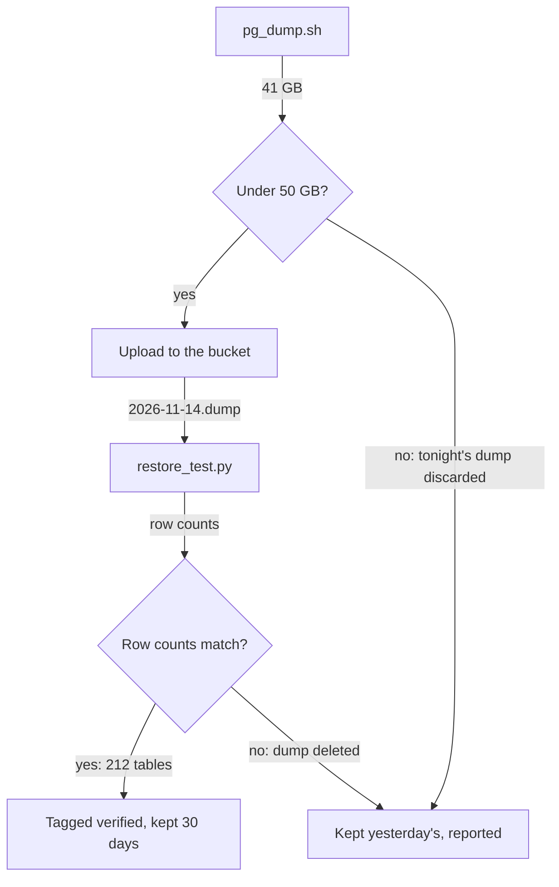

# Writing a canvas

A canvas explains logic as diagrams the reader reads along: a frame's detail sits in its
boxes, as cards, so following the arrows is reading the explanation.

**The principle:** each line sits where the reader is when they need it, in the card of
the box it is about, defined before it is used, and said once.

- The checker (SKILL.md check 1) holds every limit and says what to change; rule 20 lists
  them for when it can't run.

Contents: The page · The reader 1–3 · The intro 4 · A frame 5–12 · Failures 13 · Words
14–17 · Names and marks 18–19 · A worked frame · If the checker can't run 20

## The page

- **Intro:** the text before the first `##`. The page opens on it and frame 1, so a long
  intro hides frame 1.
- **Frames:** each `##` section; its ```` ```mermaid ```` blocks are drawn by Pele, the
  page's Mermaid parser.
- **Cards:** right after a flowchart, a list item moves into a box when it opens with the
  box's first label line in bold, exactly (`- **Board answers?** Yes on …`), or with a
  code box's name in a code span (``- **`serve()`**: answers …``).
  - Any item that opens that way becomes a card, meant or not; one that matches no box
    stays outside.
  - The page draws the bold label as the box's title and drops it from the card.
  - A decision that holds a card draws as a hexagon.

## The reader

1. **The reader** knows software well, hasn't read the source, and comes back later: the
   canvas is their source of truth. They read the diagrams first, along the arrows.
2. **Every fact once.** Every decision, rule, number, branch and failure path, with each
   step's done check where the source gives one (don't invent one), however long it gets.
   Cut copies, never facts.
   - Where the source leaves something open, or two of its rules overlap, say what that
     means for the run: "runs after the upload; nothing orders it against the cleanup",
     not "the source says only …".
   - Because: a missing fact is one the reader lacks, and a copy is one more to compare.
3. **One name per thing, one meaning per name.**
   - Define a term at its first use, in reading order: what it is, which code writes and
     reads it, and every step it applies to.
     - Terms include placeholders (`<raw>`), letters for counts (U), and words the source
       coins (split, sweep).
     - In the card of the box it is about; a term the whole frame uses, in a line under
       the heading, before the diagram.
       Where a later frame has the full definition, the first use still gets about five
       words; later mentions recall it briefly.
   - Name each actor one way (the session; the user by name), never "you".
   - When one word would mean two things, give one of them another word. When the source
     names one thing two ways, use one name and say in its card how the other relates.
   - Because: an undefined word stops the read, and one with two meanings gives a wrong
     belief.

## The intro

4. **In this order, and nothing more:**
   - The answer in about 20 words: to the user's question, the plan's decision, or the
     file's main point. Then its steps in order, numbered as the source numbers them. Then
     the problem it solves, or what the plan changes and why.
   - One text arrow flow (rule 16) per main flow, from what sets it off (other triggers on
     a line under it): **Review:** "review this plan" → Agent → steps 1–4 → canvas in the
     browser.
   - The frames: "Core: frames **1** round start, **2** verdicts. Reference: frames **3**
     anchors". Core comes first, as frames 1 to 4 at most: the main flow the reader must
     hold.
   - In an explanation, what it covers: "Covers: `SKILL.md` in full; each file it links
     to in one line."
   - A legend for any marks used (rule 19).

## A frame

Draw the shape first, then walk the arrows writing each box's card. Text written first and
drawn after gives a list beside a picture, which the reader has to map.

5. **The heading states the frame's conclusion,** in its full terms: `## 2. A round ends
   when the tab says goodbye`, not `## 2. How a round ends`.
   - Because: the headings alone then give the argument.
6. **The form follows the logic:**

   | The logic is | Use |
   | --- | --- |
   | steps and checks that branch and join | `flowchart TD`, decisions as `{"…?"}` |
   | a path through code | `flowchart` of real places in the code |
   | messages between parties, where order matters | `sequenceDiagram`; each message's detail in a `Note right of X:` after it |
   | something moving between states | one text arrow flow per path, each from its trigger |
   | a short chain whose steps need no card | a text arrow flow |
   | data with fields | a table |

7. **The shape:** each box a short label; each arrow says what passes along it, what
   triggers it, or which way a decision went.
   - The happy path first. A branch the logic chooses stays in the diagram; only a path
     where something breaks moves to a failure frame (rule 13).
   - Every way out of a decision or a loop is its own arrow, a loop's limit included,
     labelled with where it leaves things: `|"5th pass: the rest marked unknown"|`. Draw
     the ways the example (rule 8) doesn't take too.
   - When the source numbers its steps, each step's box and card label open with the
     number (`3 Rebuild the list`), and later mentions use it: "step 3".
8. **One concrete case** runs through the canvas, its values on the arrows:
   `|"yes: 7 days old"|`.
   - Set it up in frame 1's first line (`In the example, …`). A later frame gets a setup
     line only for an input no arrow carries.
   - Its counts add up across core frames (23 in, 1 dropped, 22 out), each on the arrow where
     it changes. In a plan, say the values are an example.
9. **Each box's card,** in the order the arrows reach it, holds what the reader needs there
   that its label and arrows don't say. A box whose label says it all takes none.
   - A step's card: what it does and why (in a plan, what changes and why); then its
     conditions and limits, the files it names, where its output goes.
   - A decision's card: what counts as yes, in a line or two, never the question again.
     What a branch does goes on its arrow, or in the card of the box it leads to.
   - The card is what follows the bold label, so it reads on its own: `**7.4 Look**: on a
     salary site, …`, never `**7.4 Look**, on …`.
10. **Outside the diagram,** only: under the heading, the setup line and any term the whole
    frame uses; a line about the whole frame, not one box ("all run inside the 08:00 job's
    5-minute limit"); a table of up to two field rows; and the step's done check where the
    source gives one, `**Done when:**` (in the last frame of a step split over several,
    naming the frames it spans). Everything else goes in a card.
    - Under text arrow flows, each line opens with its step, in the flow's order.
    - Because: a line about one box, left outside, is one the reader has to map to it.
11. **No copies, no conflicts.** A card, arrow or line never says again what a label,
    arrow, card or table row says (the done check aside), and never says otherwise: the diagram and its cards
    make one claim. A card doesn't retell the order, which the arrows show, but states what
    the diagram only implies, such as a count. A detail two frames need is spelled out in
    the first one read.
12. **A core frame and its cards fit one screen:** about six boxes and twenty short card
    lines.
    Bigger: split where the flow splits, the rest a reference frame starting from the box
    it leaves, named exactly as there.
    - Reference frames hold every rule, number and edge case, and may run past a screen.
      Draw them with cards wherever their logic branches; a longer table of fields gets a
      frame of its own.

## Failures

13. **Every path where something breaks is drawn** (an exception, a timeout, a crash, a race,
    a lost message), after the happy path it leaves: from that step's box, labelled exactly
    as there, to its outcome, retried, reported or stopped.
    - A diagram, or one text arrow flow per failure: a skim sees drawings, not bullets.
    - One frame per failure, or one shared by short ones; core when the whole needs it.
    - Where the reader would guess wrong, say what they'd expect and what happens instead.
    - Because: an exception met before its rule can't be placed.

## Words

14. **Short bullets, the detail in sub-bullets.** One fact per bullet, about 20 words.
    Shorten this way, never by dropping a fact:
    - each detail on the word it qualifies: "filters by pay, date and language";
    - the rule first, its reason short after it: "Never rescan: that lists the next batch";
    - the agent's instructions as commands: "Stage only …";
    - no count of the list that follows, no line announcing the next, no recap, no hedge
      that carries no doubt. Keep the words that carry meaning: because, so, unless.
15. **The reason with the rule.** When the source gives none, say what follows from the rule
    rather than invent one. When a later frame does what a reason seems to forbid, say
    there what differs.
    - Because: a rule without its reason can't be applied to a new case.
16. **A text arrow flow** is a paragraph of its own, names in code spans: `scan()` → reads
    the boards → `write()` → saves the list. Too long for a line, it becomes numbered steps.
17. **Repair before you add.** In a revision round, fix the line where it stands; a line
    added beside it is a copy.

## Names and marks

18. **Names in a form the page finds,** in text and labels; it turns them orange: `file: name()`, `name()`,
    `file: Type`, or a path from the repository root with a source extension, lines
    optional (`src/server.ts:42-60`).
    - In a code span, a bare identifier counts when qualified, camelCase or snake_case.
    - A box named after code is labelled with just the name, plus lines only for a block
      inside a longer function.
    - A plan writes names it will create the same way; they stay plain until they exist.
19. **Three marks,** defined in each diagram that uses them and named in the legend:

    ```
    classDef new stroke-width:3px,stroke-dasharray:6 3
    classDef changed stroke-width:3px
    classDef fail stroke:#dc2626,color:#dc2626
    ```

    - A plan that changes code draws the code it touches, from where the call starts to
      where it ends, `new` or `changed` on what it adds or alters, each with a card. A plan
      that reshapes a flow shows it before and after.
    - Legend: "Dashed border: new. Thick border: changed. Red: a failure. Orange name:
      exists in the code."

## A worked frame

From a canvas about a nightly backup job.

~~~markdown
## 1. A backup is kept only after a restore of it matches the replica

In the example, the 02:00 run on 14 Nov.



- **`pg_dump.sh`**: dumps the database in custom format, so one table can be restored alone.
  - Reads the replica, never the primary, so writes don't slow down.
- **Under 50 GB?** The bucket's limit for one upload.
- **Upload to the bucket**: named by the date, so a restore finds the night by name.
- **`restore_test.py`**: restores the dump into a scratch database and counts each
  table's rows, because a dump that won't restore isn't a backup.
- **Row counts match?** Yes when every table equals the replica's count at dump time.

- **Done when:** the bucket has tonight's dump tagged `verified`, or the report says why not.
~~~

## If the checker can't run

20. **The limits:** a heading 70 characters, a text arrow flow 85, a bullet 40 words, a
    card 5 lines (a decision's 2), outside lines a quarter of a frame's, a core frame one
    screen, four core frames.
    - **Read each block for what breaks Pele,** which shows the reader raw source instead:
      - a `;` in a sequence diagram ends the statement: write "," or "and";
      - a node ID Mermaid reserves (`end`, `subgraph`, `graph`, `flowchart`, `style`,
        `class`, `classDef`, `click`, `linkStyle`, `call`): call it `done`;
      - a label or edge label with punctuation, unquoted: `A["serve(): POST /open"]`,
        `A -->|"verdict, comments"| B`.
