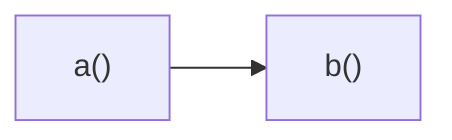

<!--
Fixture for check_diagrams.js's exit 1 and a Core line without bold. Run:
  node skill/graphify-review/scripts/check_diagrams.js skill/graphify-review/scripts/fixtures/broken.md
It must print exactly the lines in broken.expected and exit 1.
-->

# Broken fixture

Core: frames 1 and 3. Reference: frame 2.

## 1. A node named end breaks the diagram

```mermaid
flowchart LR
  start["Start"] --> end["End"]
```

## 2. This one draws



## Frame three has no number in its heading

`a()` → `b()`
