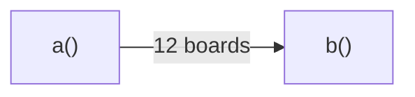
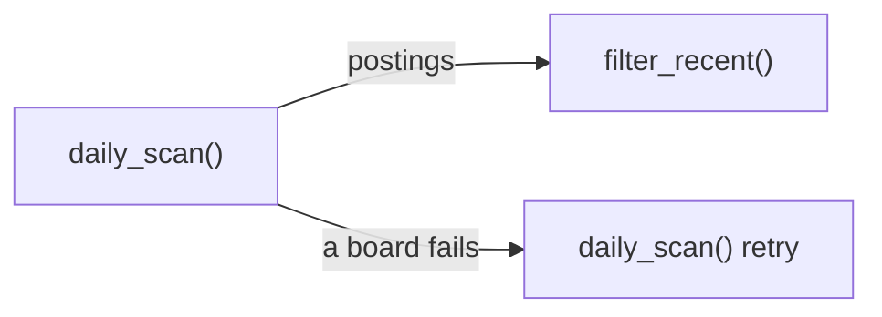
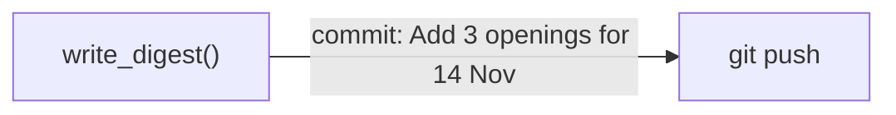
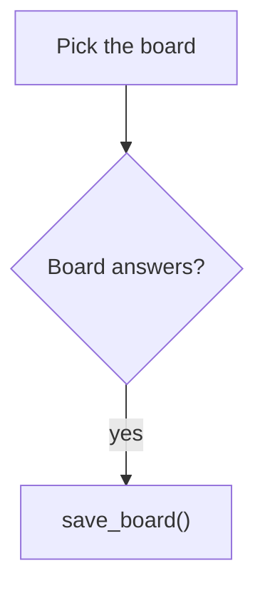
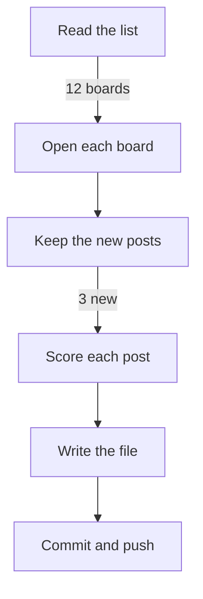
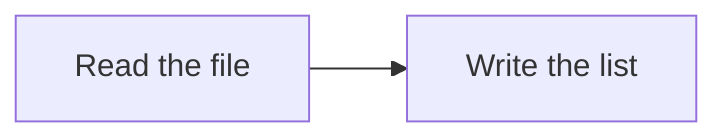
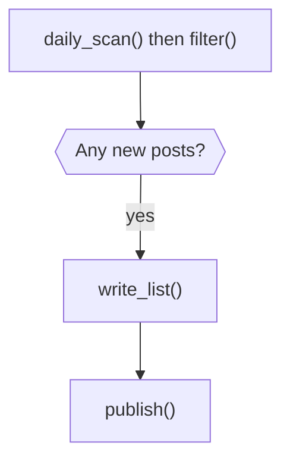

<!--
Fixture for check_diagrams.js's writing warnings. Run:
  node skill/graphify-review/scripts/check_diagrams.js skill/graphify-review/scripts/fixtures/warnings.md
It must print exactly these lines and exit 0:
  All 7 diagrams draw.
  warn: line 36: intro lists 5 core frames, 4 fit: keep the main flow in four, move 1 to reference; edit this line, each heading and every "frame N" that moves
  warn: line 36: core frames are 1, 2, 3, 5, 8: core comes first, as frames 1 to 5; renumber so the main flow opens the canvas, editing each heading, this line and every "frame N" that moves
  warn: line 47: heading is 71 characters, 70 fit: cut 1: "2. A heading of seventy-one characters, as drawn, gives one warning now"
  warn: line 55: text arrow flow is 86 characters, 85 fit: cut 1, or make it numbered steps: "scan() → reads the boards → filter() → drops the old ones → write() → saves the lists."
  warn: line 66: 8 words also at line 64: say it once, where the reader first needs it: "postings older than fourteen days are dropped each"
  warn: line 97: 11 words also at line 94: say it once, where the reader first needs it: "the day s openings one row per posting with its link"
  warn: line 99: frame draws nothing, so a skim sees only its heading: give it a diagram, a text arrow flow or a table: "6. Text past forty words warns; sub-bullets and code spans don't add"
  warn: line 102: bullet is 41 words, 40 fit: move its detail into sub-bullets: "forty one words red orange yellow green blue …"
  warn: line 108: paragraph is 41 words, 40 fit: move its detail into sub-bullets: "forty one again as a paragraph north south …"
  warn: line 124: decision card "Board answers?" is 3 lines, 2 fit: say what counts as yes; move what a branch does to its arrow or the next box's card
  warn: line 127: card "save_board()" is 6 lines, 5 fit: split the box into two steps; a step that can't split keeps its summary in its card, the rest in a reference frame
  warn: line 133: card label "Board answer?" matches no box, so it stays outside: make it the box's first label line exactly, "Board answers?"
  warn: line 138: setup line's numbers (12, 3) are all on the frame's arrows: delete it, or keep only an input no arrow carries: "In the example, 12 boards are read and 3 posts are new."
  warn: line 140: core diagram with its cards is 1137 tall, 1100 fits (3% over): cut 3 of its 21 card lines, longest cards first ("Keep the new posts" 4, "Score each post" 4, "Write the file" 4): move that detail to a reference frame, then stop: "8. A core diagram that its cards make taller than one screen warns"
  warn: line 168: 2 lines outside the diagram, 3 in its cards; 1 may sit outside: move 1 into the cards of the boxes they're about: "9. A quarter of lines outside warns, and so does a card mid-sentence"
  warn: line 175: card "Read the file" draws as ", line by line: each row is one company." once its label is the title: follow the label with ": " and a clause that reads alone
  warn: line 176: card "Write the list" draws as "it builds:" once its label is the title: follow the label with ": " and a clause that reads alone
  warn: line 199: decision card "Any new posts?" is 3 lines, 2 fit: say what counts as yes; move what a branch does to its arrow or the next box's card
Frame 6 is prose alone, so it also warns that it draws nothing. Everything else in it sits
just under a limit, or repeats fewer than 8 words, and gives no warning. Frame 1's setup
line, the done checks, frame 10's two-row table and its text block give none either: frame
10's cards match as the page matches them, and `filter()` and `publish()` stay outside.
-->

# Warnings fixture

Each frame below sits on one side of a limit. The intro is sentences rather than bullets, so it may
run past the forty-word limit that frame text has: this paragraph does, by design, and still
gives no warning at all, however many more words it goes on to use.

Core: frames **1–3** headings, **5** cards, **8** heights. Reference: frames **4**, **6–7**, **9** limits, **10** matching.

## 1. A heading of exactly seventy characters, as drawn, gives no warning

In the example, 12 boards are read; the first frame's setup line gives no warning.



## 2. A heading of seventy-one characters, as drawn, gives one warning now

`c()` → `d()`

## 3. A `code` span and **bold** marks don't count toward this limit at all, ok

`scan()` → reads every board → `filter()` → keeps the new ones → `write()` → writes a file.

`scan()` → reads the boards → `filter()` → drops the old ones → `write()` → saves the lists.

- A list item with an arrow is a bullet, not a text arrow flow: `scan()` → reads → `filter()` → drops → `write()`

| A table cell with an arrow is not a flow either: `scan()` → reads → `filter()` → drops → `write()` → saves |
| --- |

Seven: the scan runs once every single morning.

Eight: postings older than fourteen days are dropped each morning.

Again, the scan runs once every single morning, and postings older than fourteen days are dropped each day.

## 4. A box's name in its label, card and text is no repeat



- **`daily_scan()`**: reads each company's board once a day.
- **`filter_recent()`**: keeps what the last 14 days posted.
- **`daily_scan()` retry**: reads a failed board once more; two labels that open with one name
  each keep their own card.

Both run inside the 08:00 cron job, so `daily_scan()` and `filter_recent()` share its 5-minute limit.

## 5. A paragraph that restates the table gives a warning



- **`write_digest()`**: writes the day's file and commits it.

| File | What it holds |
| --- | --- |
| `openings/2026-11-14.md` | the day's openings, one row per posting with its link |

`write_digest()` commits with the message "Add 3 openings for 14 Nov" and writes
`openings/2026-11-14.md`: the day's openings, one row per posting with its link.

## 6. Text past forty words warns; sub-bullets and code spans don't add

- Forty words: alpha bravo charlie delta echo foxtrot golf hotel india juliet kilo lima mike november oscar papa quebec romeo sierra tango uniform victor whiskey xray yankee zulu one two three four five six seven eight nine ten eleven twelve.
- Forty-one words: red orange yellow green blue indigo violet black white grey brown pink cyan magenta teal navy olive maroon silver gold beige coral ivory khaki lavender lime mint peach plum rust salmon sand tan wheat amber azure bronze copper.
- **Resume:** start at step three.
  - Sub-bullets are counted apart from their parent, so this detail and the next one can run on without making the parent bullet long.
  - The next one adds more words again, which still leaves the parent bullet at five words of its own.
- Code span as one: `python3 skill/daily-openings/scripts/pay_panes.py report 2026-11-14 --verbose --dry-run` prints the counts, and nothing else here comes close to forty words because each long command, path or flag inside backticks counts once.

Forty-one again, as a paragraph: north south east west up down left right in out over under above below near far early late soon now then here there where when why how who what which first second third last next.

## 7. Any box takes a card by its label, and a near miss stays outside

In the example, the board is Acme's, read on 14 Nov, so the setup line gives no warning.



- **Pick the board** takes the saved board, or guesses one.
- **Board answers?** Yes on a 200 with at least one job.
  - A 200 with no jobs counts as no.
  - So does a redirect to a sign-in page.
- **`save_board()`**: writes the board to the list.
  - one
  - two
  - three
  - four
  - five
- **Board answer?** A label one letter off a box's stays outside, and warns.
- **Done when:** the board is saved. A bold label with no box near it is a frame line.

## 8. A core diagram that its cards make taller than one screen warns

In the example, 12 boards are read and 3 posts are new.



- **Read the list**: the companies file, one name per row.
  - Rows that start with a hash mark are skipped.
  - A blank row ends nothing; the read goes on.
- **Open each board**: the saved board link, or a guess from its name.
  - One request at a time, five seconds apart.
  - A board that times out is tried once more.
- **Keep the new posts**: only the last fourteen days.
  - A post with no date is kept and flagged.
  - Duplicates across boards keep the first seen.
  - A post edited since yesterday counts as new again.
- **Score each post**: years asked, title and city.
  - Three to seven years scores best.
  - Remote roles count as the home city.
  - A title that names a lead role scores lower.
- **Write the file**: one row per post, newest first.
  - The link goes last in each row.
  - An empty day writes a single line saying so.
  - The file is named by the date, so reruns overwrite it.
- **Commit and push**: one commit with the date.
  - A push that fails stops the run.
  - Nothing is retried after that.

## 9. A quarter of lines outside warns, and so does a card mid-sentence



- **Read the file**, line by line: each row is one company.
- **Write the list** it builds:
  - one row per opening.
- **Runs when:** every morning at eight.
- **Done when:** the list has today's date.

The list is read by the morning digest.

## 10. Cards match the way the page matches them



```text
A text block between a diagram and its cards doesn't end them.
```

- **`daily_scan()`**: reads every board and keeps the postings from the last fourteen days.
  - One request per board.
- `filter()` isn't the label's first name, so it stays outside the boxes.
- **Any new posts?** Yes when a posting is newer than yesterday's list.
  - A hexagon is a decision, so its card fits 2 lines.
  - This is the third.
- write_list() opens with a plain-text name, so it is that box's card.

| Field | Holds |
| --- | --- |
| date | the day |
| link | the posting |

- **Done when:** the list reads every board and keeps the postings from the last fourteen days.

### A sub-heading ends the cards

- **`publish()`**: after a heading, so it stays outside.
